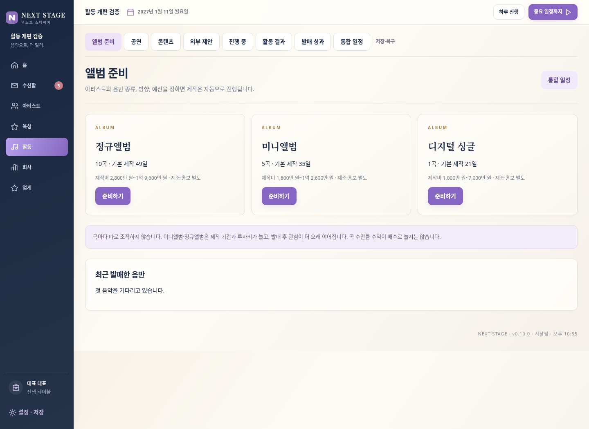
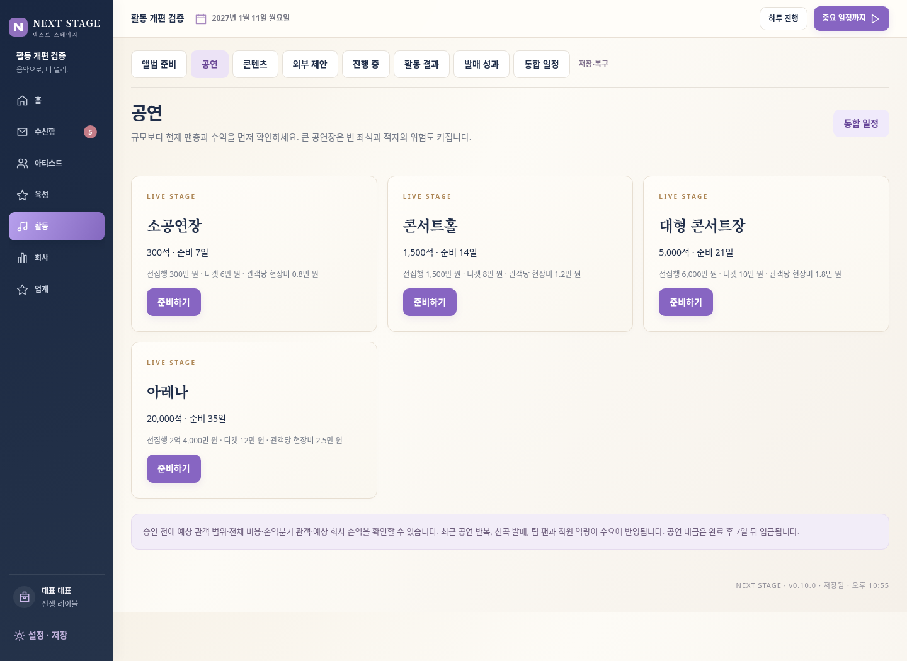

# NEXT STAGE v0.10.0

- [게임 전체 ZIP 다운로드](https://github.com/dkmoon26-cmyk/singsing/raw/refs/heads/download-next-stage-v0100/NEXT-STAGE-v0.10.0-web-deploy-under-100.zip)
- [개발 소스 ZIP 다운로드](https://github.com/dkmoon26-cmyk/singsing/raw/refs/heads/download-next-stage-v0100/NEXT-STAGE-v0.10.0-source.zip)

하루 기록 메뉴·버튼·전용 창을 제거했습니다.
활동을 앨범 준비·공연·콘텐츠·외부 제안과 진행 중·활동 결과로 정리했습니다.
정규앨범 10곡·미니앨범 5곡·디지털 싱글 1곡을 준비할 수 있습니다.
공연은 소공연장 300석·콘서트홀 1,500석·대형 콘서트장 5,000석·아레나 20,000석으로 나누고 승인 전 예상 관객·총비용·손익분기·회사 손익을 표시합니다.
커버·연습·일상/소통 콘텐츠와 반복 효과 감소를 추가했습니다.
외부 광고·행사 섭외는 수신함과 동일한 데이터로 처리합니다.
개인 팬과 인지도는 아티스트 목록·개인 육성에서 확인할 수 있습니다.

검증: 모든 새 활동 완료·정산·입금, 행사 예약과 앨범 제작 연장, 중복 섭외 처리 방지,
자금 부족·잘못된 입력 원복, 저장 후 이어하기, PC/모바일 5가지 폭,
기존 0.9.1 저장 불러오기·400일 진행·백업·육성·상단 진행 버튼 회귀를 통과했습니다.
배포 ZIP을 별도로 풀어 검사했습니다. 게임 ZIP은 82개 파일입니다.

기존 버전에서 설정 → JSON 백업을 내보낸 뒤 새 버전에서 불러오세요.
게임 ZIP을 풀고 index.html을 엽니다. 같은 웹 주소에서 교체하면 기존 브라우저 저장을 이어 쓸 수 있습니다.
기존 main과 이전 전달 브랜치는 변경하지 않았습니다.

[모바일 화면](preview-mobile.png)
