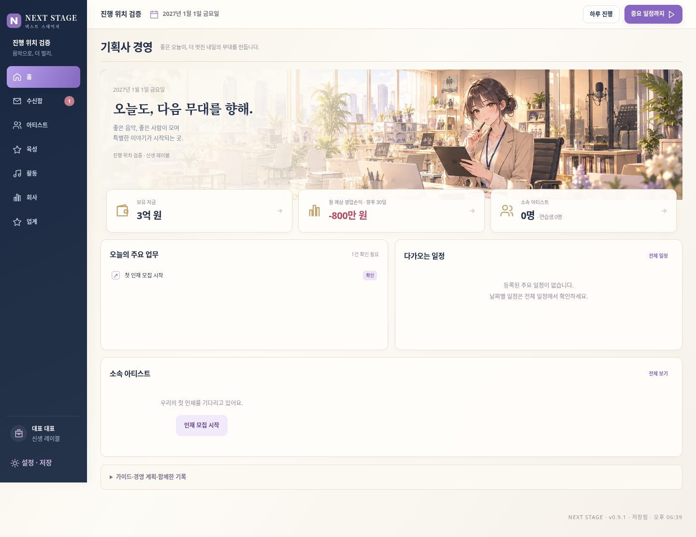

# NEXT STAGE v0.9.1

- [게임 전체 다운로드](https://github.com/dkmoon26-cmyk/singsing/raw/refs/heads/download-next-stage-v091/NEXT-STAGE-v0.9.1-web-deploy-under-100.zip)
- [개발 소스 다운로드](https://github.com/dkmoon26-cmyk/singsing/raw/refs/heads/download-next-stage-v091/NEXT-STAGE-v0.9.1-source.zip)

상단 오른쪽에 하루 진행·중요 일정까지 진행·중지 버튼을 모든 게임 화면에서 표시합니다.
상단의 보유 자금과 수신함 바로가기를 제거하고 수신함은 왼쪽 메뉴로 복원했습니다.
소속 아티스트 영역의 하루 진행 버튼을 제거했습니다. 모바일 하단 수신함은 유지합니다.

검증: 5개 화면 폭 × 9개 화면의 진행 버튼 노출과 넘침, 수신함 배지·이동,
실제 하루 진행·자동 진행·수동 중지, 기존 게임·육성·저장 회귀.
배포 ZIP을 별도로 풀어 검증했습니다. 게임 ZIP은 82개 파일입니다.

ZIP을 풀고 index.html을 엽니다. 기존 진행은 이전 버전에서 JSON 백업 후 새 버전으로 불러오세요.
기존 main과 이전 전달 브랜치는 변경하지 않았습니다.

[모바일 홈](preview-mobile.png)
