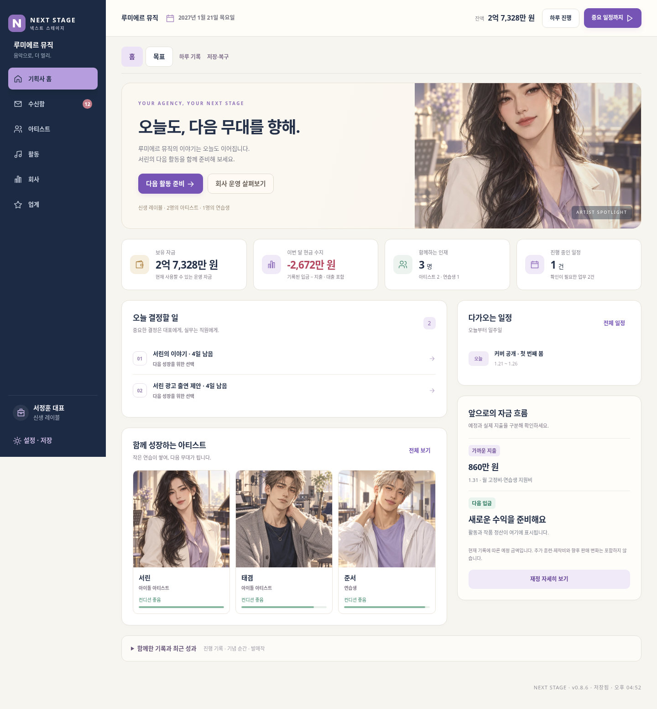
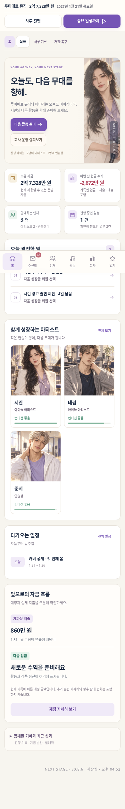

# NEXT STAGE v0.8.6 · UI 업데이트

- [게임 전체 ZIP 다운로드](https://github.com/dkmoon26-cmyk/singsing/raw/refs/heads/download-next-stage-v086/NEXT-STAGE-v0.8.6-web-deploy-under-100.zip)
- [개발 소스 ZIP 다운로드](https://github.com/dkmoon26-cmyk/singsing/raw/refs/heads/download-next-stage-v086/NEXT-STAGE-v0.8.6-source.zip)

게임 ZIP을 풀고 index.html을 엽니다. 이전 진행은 기존 버전의 설정에서 JSON 백업을 내보낸 뒤 새 버전에서 불러오세요.

## 변경 내용

네이비·아이보리·라벤더 디자인, 경영 홈 재구성, 업무·인물·일정·자금 계획 정리,
기록 영역 접기, 모바일 화면·공통 카드·버튼·모달·키보드 포커스 개선.
72명 캐릭터와 게임 규칙·저장 형식은 유지했습니다. 게임 ZIP은 81개 파일입니다.

검증: v0.8.5 저장 호환, 전체 72명 이미지, 400일 진행, 계약·활동·백업,
12개 화면 × 5개 해상도, 인물 상세·일정 이동·기록 영역 펼침 유지.
배포 ZIP을 별도 폴더에 풀어 동일 검증을 통과했습니다.

## 화면

기존 main과 v0.8.5 전달 브랜치는 변경하지 않았습니다.
