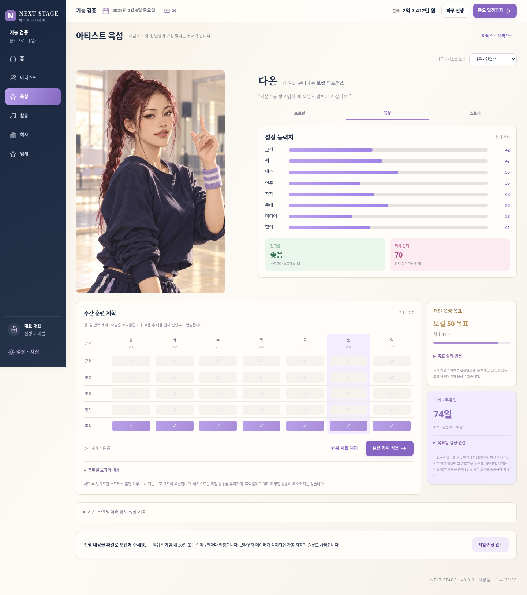

# NEXT STAGE v0.9.0

- [게임 전체 ZIP 다운로드](https://github.com/dkmoon26-cmyk/singsing/raw/refs/heads/download-next-stage-v090/NEXT-STAGE-v0.9.0-web-deploy-under-100.zip)
- [개발 소스 ZIP 다운로드](https://github.com/dkmoon26-cmyk/singsing/raw/refs/heads/download-next-stage-v090/NEXT-STAGE-v0.9.0-source.zip)

게임 ZIP을 풀고 index.html을 엽니다. 이전 버전 설정에서 JSON 백업을 내보낸 뒤 새 버전에서 불러오면 진행을 이어갈 수 있습니다.

## 이번 변경

시안 구조에 맞춘 사무실·매니저 배경과 3개 경영 지표, 업무·일정 나란히 배치, 가로형 인물 카드와 하루 진행 버튼.
세로 초상화가 잘리지 않는 전용 육성 화면과 월~일 반복 훈련표, 개인 능력 목표·달성 기록,
데뷔·공연·발매 목표일·확정 일정 카운트다운, 향후 30일 예상 영업손익.
의상 변경과 캐릭터 보이스는 포함하지 않습니다.

훈련 계획과 목표를 별도로 설정합니다. 목표일은 활동 자동 예약이 아닙니다.
월 예상 영업손익은 현재 계획의 별도 30일 시뮬레이션이며 대출·원금·이자·비영업 지원금을 제외합니다.
신규 선택·계약·활동은 반영하지 않으므로 실제 결과와 달라질 수 있습니다.

## 검증

기존 v0.8.6 저장 호환, 전체 72명 이미지, 기존 게임 흐름·400일 진행·슬롯·JSON 백업,
주간 훈련 성장·휴식·요일 순서·해제 시 원복·잘못된 입력 롤백,
목표 일회성 보고와 실제 데뷔 달성, 예측 상태·난수 불변·금융 제외·별도 정산 대조,
설정 저장 후 재접속, 13개 화면 × 5개 해상도, 새 폼과 손익 상세.
최종 배포 ZIP(82개 파일)을 별도 폴더에 풀어 재검증했습니다.

## 화면

[모바일 홈](preview-mobile-home.png) · [모바일 육성](preview-mobile-development.png)

기존 main과 이전 전달 브랜치는 변경하지 않았습니다.
